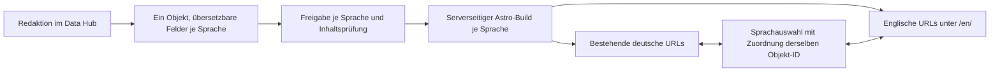

# Mehrsprachigkeit für kieks.me und Payload Data Hub

Umsetzungsstand und Aktivierung: [Mehrsprachige Website und CMS-Vorschau](localization.md).

Konzept vom 15. November 2026. Noch keine produktive Schema-Migration und keine
Übersetzungen veröffentlicht. Ausgangspunkt: **Deutsch und Englisch**, weitere
Sprachen später konfigurierbar. Deutsch bleibt die Standardsprache.

## Ziel und vorhandene Architektur

Redaktionelle Inhalte bleiben in `datahub.kieks.me` gepflegt. Astro erzeugt die
öffentlichen Seiten statisch; CMS-Zugangsdaten bleiben im Build und kommen nicht
in Browser, URLs oder öffentliche Artefakte. Die Sprachauswahl führt auf eine
eigene URL der gewählten Sprache, statt nur clientseitig Texte auszutauschen.

Im untersuchten Datahub-Repository ist Payload **4.0.0-beta.6** konfiguriert;
dies ist keine Feststellung zur aktuell ausgerollten Produktionsversion.
`src/payload.config.ts`, `src/website.ts`, `src/editorial/seo.ts` und die
Preview-/Publish-Verträge bilden die Backend-Basis. Auf Website-Seite sind
`src/utils/payload-build.ts`, `src/utils/site-content.ts`, `src/content-model/`
und die Astro-Seiten betroffen. Der bisherige Client ist nicht locale-spezifisch.

## Datenmodell: dieselben Objekte, mehrere Sprachfassungen

Payload-Feldlokalisierung verwenden, keine separaten Collections `posts-en`
und keine Kopien von Personen oder MCP-Objekten je Sprache. Bestehende IDs und
Beziehungen bleiben stabil. Nur sprachabhängige Felder erhalten `localized: true`.
Das ist Content-Lokalisierung; die Sprache der Payload-Admin-Oberfläche ist davon
unabhängig.

| Objekt                                           | Übersetzbare Felder                                                                | Gemeinsam / sprachunabhängig                                                               |
| ------------------------------------------------ | ---------------------------------------------------------------------------------- | ------------------------------------------------------------------------------------------ |
| Seiten einschließlich Startseite und Rechtstexte | Titel, Hero-/Abschnittstexte, Markdown/Rich Text, redaktionelle CTA-Texte, SEO     | ID, pageKind, stabile Kennung, Layout-/Blocktypen                                          |
| Blogartikel (`posts`)                            | Titel, Kurzfassung, Rich Text, öffentlicher Slug, SEO, sprachabhängige Bildtexte   | ID, Autorbeziehungen, Artikelidentität; fachliche Veröffentlichungsdaten bewusst festlegen |
| MCP-Projekte (`mcp-projects`)                    | Name/Beschreibung soweit redaktionell, Kurztext, Rich Text, SEO, öffentlicher Slug | ID, Repository, npm-Paketnamen, Lizenz, technische Kennungen/Versionen                     |
| Leistungen (`services`)                          | Titel, Kurztexte, Highlights, Detailtexte, Linkbeschriftung, SEO                   | stabile Leistungskennung, Reihenfolge, Gestaltung                                          |
| FAQ (`faqs`)                                     | Frage, Antwort/Rich Text, sichtbare Kategorienamen                                 | ID, Platzierung und Reihenfolge; Taxonomie-IDs bleiben gleich                              |
| Autoren-/Trainerprofile (`authors`) und Team     | Funktion, Bio, Bildbeschreibung, redaktionelle Profiltexte                         | Personen-ID, Name, echte Identität, Porträtdatei; private Auth-Benutzer bleiben privat     |
| Trainings                                        | Titel, Teaser, Beschreibung, Lernziele, Voraussetzungen, SEO, öffentliche URL      | ID, Trainerbeziehungen, Dauer, Termin-Zeitpunkte, numerische Preise/Währung                |
| Navigation                                       | Beschriftungen, redaktionelle CTA-/Footertexte                                     | Menütaxonomie und interne Dokumentbeziehungen; externe URLs nicht automatisch übersetzen   |
| Medien (`media`)                                 | Alttext, Bildunterschrift; bei Text im Bild sprachabhängige Asset-Zuordnung        | gemeinsame Binärdatei nur wenn sprachneutral, Maße, MIME-Typ und Rechte                    |

**Trainingssprache ist ein eigenes fachliches Merkmal**, nicht die Sprache der
Website: Ein deutsches Training kann in einer englischen Beschreibung angeboten
werden. Preise nicht automatisch umrechnen und Personen-/Paketnamen nicht erfinden
oder maschinell als andere Identitäten übersetzen. Blog-Kategorien/Tags als
lokalisierbare Taxonomie pflegen, wenn sie als eigenständige Objekte vorliegen.

Bestehende `slug`-Werte dienen teils als technische Schlüssel für Templates und
Zuordnung (`startseite`, `cloud-devops`, `andre`). Diese nicht blind lokalisieren.
Ein zusätzliches lokalisiertes Feld `pathSlug` für öffentliche URLs vorsehen;
Eindeutigkeit innerhalb von Collection + Sprache prüfen. Alte deutsche Pfade
und bestehende interne Identifikatoren bleiben erhalten.

## Sprachen, Freigabe und Fallback

- Locale-Codes `de` und `en`, Standard `de`. Inhaltliche Fallbacks für öffentliche
  fremdsprachige Seiten deaktivieren. Keine englischen URLs mit unbemerkt
  deutschen Texten als angeblich fertige Übersetzung veröffentlichen.
- Neue englische Fassung zunächst als Entwurf. Eine Übersetzung darf die bereits
  veröffentlichte deutsche Fassung nicht zurückziehen oder einen fremdsprachigen
  Entwurf öffentlich machen.
- Payload dokumentiert `versions.drafts.localizeStatus` als Beta, zusätzlich mit
  globalem `experimental.localizeStatus`. Vor Einsatz im tatsächlichen Beta-6-
  Schema prüfen und auf einem Datenbankklon testen. Dies ist kein Auftrag, ein
  experimentelles Flag ungeprüft produktiv einzuschalten.
- Abnahmebedingung ist unabhängige Veröffentlichung je Locale. Falls die native
  Variante nicht stabil funktioniert, einen expliziten serverseitig geschützten
  Locale-Freigabestatus verwenden. Ein gemeinsames `_status=published` allein
  ist keine ausreichende Absicherung für Sprachentwürfe.
- Pflichtprüfung je Sprache: Titel, Text, URL, Meta-Daten, erforderliche Alttexte
  und Links vollständig; Ansprechpartner/Trainer dürfen nur veröffentlichte
  öffentliche Profile sein. Externe Dokumentation nur dann als übersetzt
  kennzeichnen, wenn eine echte entsprechende Sprachfassung existiert.
- Fehlt eine englische Übersetzung, keine englische Inhaltsseite generieren und
  keinen hreflang-Link dorthin ausgeben. Der Sprachschalter zeigt die fehlende
  Fassung als nicht verfügbar. Ein zusätzlicher expliziter Link darf auf die
  englische Übersicht führen; kein stiller Wechsel zu einem anderen Artikel.

## Frontend und URLs

Deutsch behält `/`, `/blog/...` und `/leistungen/...`. Englisch liegt unter
`/en/`, beispielsweise `/en/blog/...`, `/en/services/...` und `/en/trainings/...`.
Eine zentrale Route-Tabelle löst Collection, stabile Objekt-ID, Locale und
`pathSlug` auf. Derselbe Artikel kann dadurch verschiedene öffentliche Slugs
besitzen; der Sprachschalter verknüpft Objekte anhand der ID, nicht per String-
Ersetzung eines deutschen Pfades.

Der Header erhält **Deutsch / English** mit sichtbaren Sprachbezeichnungen und
Tastaturbedienung. Keine Flaggen als alleinige Kennzeichnung. Navigation,
Footer, Formulare, Validierungs-/Erfolgstexte und Buttons müssen zur Route passen.
Redaktionelle Beschriftungen kommen aus Payload; rein technische UI-Texte aus
einem typisierten Locale-Wörterbuch im Repo. Datums-/Zahlenformatierung anhand
der aktuellen Locale instanziieren, statt einen globalen deutschen Formatter
für alle Seiten zu verwenden. Interne CMS-Links bevorzugt als Dokumentbeziehungen
auflösen; harte `/kontakt`-Strings nicht blind um `/en` ergänzen.

Die Locale steht in der URL. Optional gespeicherte Sprachpräferenz darf die
bewusst geöffnete URL nicht übersteuern. Keine erzwungene IP-/Browser-Weiterleitung,
damit verlinkte Seiten, Suchmaschinen und Zurück-Navigation verlässlich bleiben.

SEO pro tatsächlich veröffentlichter Sprachfassung: korrektes `html lang`,
eigener Canonical, wechselseitige hreflang-Links und x-default für die deutsche
Standardseite, lokalisierte Title/Description sowie Open-Graph-Locale/Bilder,
Twitter-Metadaten und Sitemap-Einträge. Bei lokalisiertem Text im OG-/Hero-Bild
separate Varianten erzeugen; ein sprachneutrales Motiv kann geteilt werden.
Veränderte veröffentlichte Slugs mit gezielten 301-Weiterleitungen erhalten.

## Build-Client, Vorschau und Rechte

Der private Payload-Client lädt jede Locale explizit, etwa
`?locale=en&fallback-locale=none&draft=false`, zusätzlich mit geprüfter
Veröffentlichungsfilterung. Keine öffentliche Nutzung von `locale=all` für die
Website-Buildrolle. API-Parameter dürfen weder Draft- noch Versions- oder
Locale-Berechtigungen aushebeln. Anonymous bleibt ohne CMS-Zugriff; die öffentliche
Website erhält ausschließlich den freigegebenen statischen Output.

Cache und Build-Snapshots nach Locale **und** Veröffentlichungsmodus trennen.
Ein globaler CMS-Snapshot oder die bisherige Media-Metadatenmap allein genügt
nicht: Alttexte, Navigation und Inhalte könnten sich sonst zwischen Builds
überschreiben. Binärbilder deduplizieren, sprachabhängige Metadaten separat halten.
Alle Content-Resolver erhalten die Locale ausdrücklich. Der Build-Schlüssel
bleibt serverseitig und darf weiterhin keine privaten Benutzer, Empfänger,
API-Keys, interne Redaktionsnotizen oder unveröffentlichte Profile lesen.

Die authentifizierte Vorschau übergibt Locale und Dokumentidentität im bestehenden
signierten Vertrag. Sprachfassungen nur für berechtigte Redakteure anzeigen,
no-store/noindex beibehalten und keine Draft-Vorschau öffentlich cachen.

Der Blog-Skill erfragt Zielgruppe und Sprachen, erzeugt Übersetzungsentwürfe
sowie passende OG-/Hero-Assets. Solange echte CMS-Lokalisierung nicht vorhanden
ist, darf er Sprachvarianten nicht durch wiederholtes Überschreiben desselben
unlokalisierten Felds simulieren. Importblocker explizit melden und vorbereitete
Sprachpakete getrennt halten. Eine aktive Veröffentlichung ist ein eigener
fachlicher Auftrag; die Entwurfserstellung braucht nach expliziter Skill-Anwendung
keine zusätzliche pauschale Bestätigung.

## Migration und Umsetzung in überschaubaren Schritten

1. Aktuelles Schema, Produktivversion und Datenmenge prüfen. Konsistentes
   Datenbankbackup und Wiederherstellung auf einem isolierten Klon testen.
2. Locale-/Feld-/Freigabemodell auf dem Klon implementieren. Bestehende deutsche
   Werte, IDs, Beziehungen, Versionshistorie und Slugs vor/nach Migration prüfen.
   Das Umstellen bestehender Felder auf `localized: true` ist eine echte
   Datenstrukturänderung und darf vorhandene Werte nicht leeren.
3. Additive Migration und Rückweg vorbereiten. Fehlende englische Werte sind
   Entwürfe, keine automatisch veröffentlichte Kopie des deutschen Texts.
4. Payload-ACL, Locale-Status und Vorschau testen. Erst danach echten
   zweisprachigen Build-Client und typisierte Route-Tabelle einführen.
5. Zuerst Navigation, Startseite und eine Beispielseite; anschließend je einen
   Blogartikel, MCP-Datensatz und ein Training mit Trainerprofil vollständig
   durchspielen. Rechtstexte redaktionell freigeben, nicht automatisch als
   verbindliche Übersetzung ausgeben.
6. Sprachewähler und SEO ergänzen. Im Preview Build alle Routen prüfen und
   dann bewusst die fertigen Sprachfassungen veröffentlichen.

Abnahmetests: keine deutschen Fallback-Texte auf einer fertigen englischen Seite;
kein Leak bei locale=all/draft=true; deutsche Fassung bleibt veröffentlicht,
während Englisch Entwurf ist; identischer Slug in verschiedenen Locales korrekt
auflösbar; Änderung eines Slugs erzeugt gültigen Redirect; Sprachschalter bleibt
beim selben Objekt; alle MCP-/Blog-/Trainingsdaten und OG-/Hero-Bilder werden in
der richtigen Sprache geladen; keine verwaisten Links oder hreflang-Ziele.

## Quellen

- [Payload Localization](https://payloadcms.com/docs/configuration/localization)
- [Payload Drafts und Status-Lokalisierung](https://payloadcms.com/docs/versions/drafts)
- [Aktueller CMS-Vertrag der Website](cms-content.md)
- Datahub: `src/payload.config.ts`, `src/website.ts`, `src/preview/contract.ts`,
  `src/access.ts` sowie `docs/editorial/website-schema.md`.
